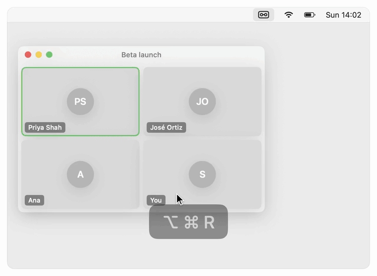
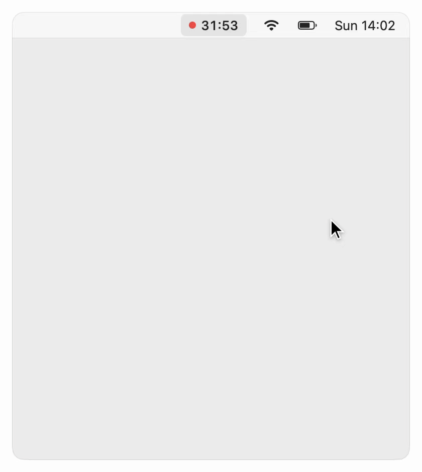
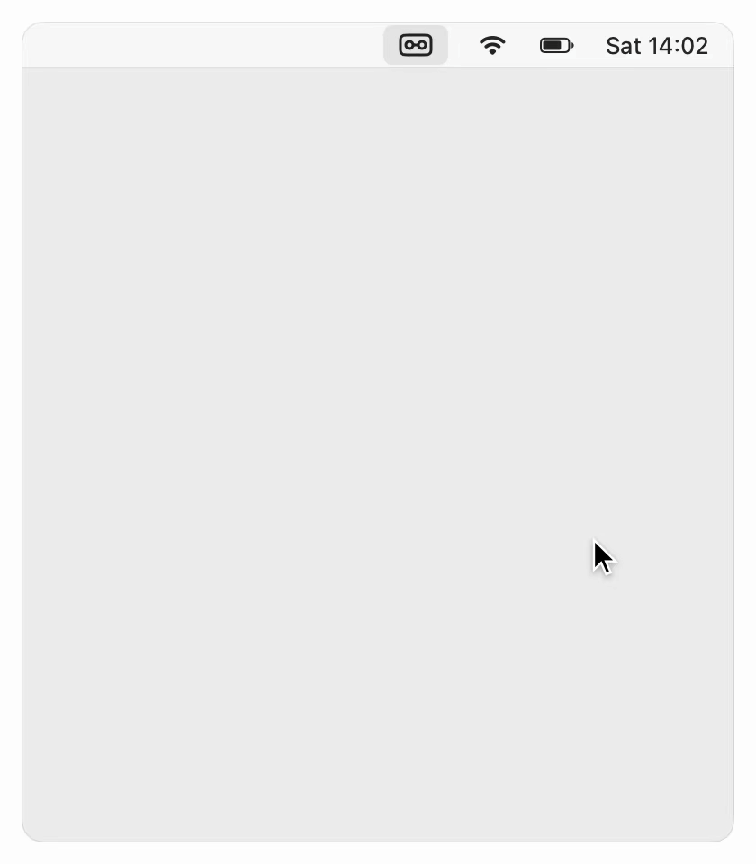
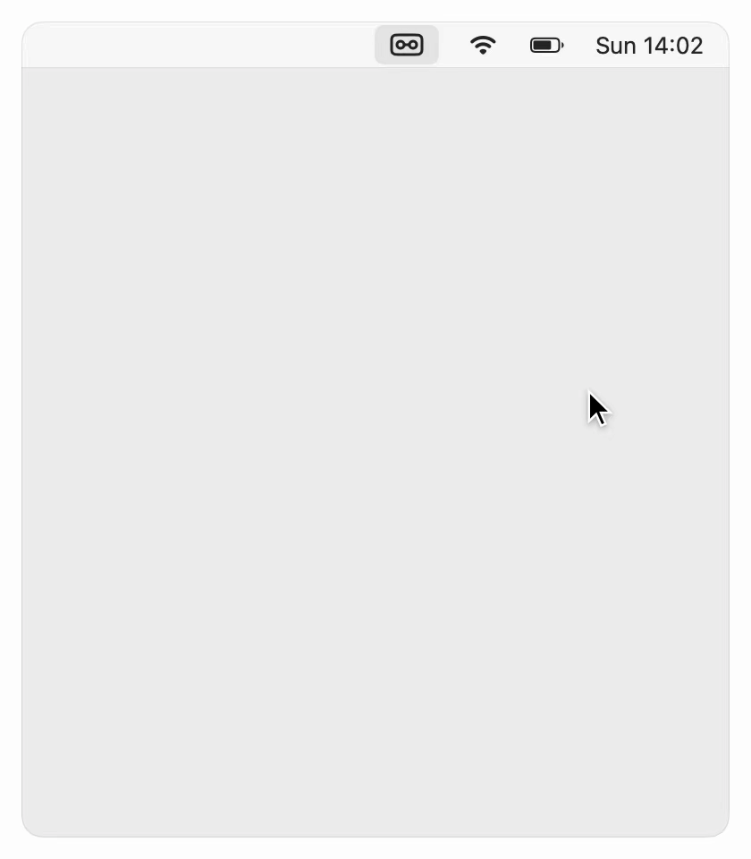

<p align="center">
  
</p>

<h1 align="center">TapeUp</h1>

<p align="center">TapeUp is a meeting recorder for Mac, built for you and your AI agent.</p>

<p align="center">
  <b>Record any meeting on your Mac. Get a transcript you and your AI agent can use.</b><br>
  A click records both sides of the call: your voice and everything your Mac plays.<br>
  TapeUp transcribes it on your Mac while you talk.
</p>

<p align="center">
  <a href="https://github.com/kkyrian/tapeup/releases/latest/download/TapeUp.dmg"><b>Download for Mac</b></a>
  &nbsp;·&nbsp; free, MIT license &nbsp;·&nbsp; Apple silicon, tested on macOS 27
</p>

```bash
brew install kkyrian/tap/tapeup
```

<p align="center">
  <picture>
    <source media="(prefers-color-scheme: dark)" srcset=".github/images/record-dark.gif">
    
  </picture>
  <picture>
    <source media="(prefers-color-scheme: dark)" srcset=".github/images/import-dark.gif">
    
  </picture>
</p>

<br>

<picture>
  <source media="(prefers-color-scheme: dark)" srcset=".github/images/floating-dark.gif">
  
</picture>

### Record from any app

Press **⌥⌘R** mid-call. Small controls float over your windows to
pause or stop, and the saved recording drops from the menu bar.

<br clear="all">
<br>

<picture>
  <source media="(prefers-color-scheme: dark)" srcset=".github/images/who-was-there-dark.gif">
  
</picture>

### Say who was there

When you stop, tap how many people were on the call and type a few
letters of each name. TapeUp suggests the people you meet with.

It's optional, and it's what a transcript can't know on its own.

<br clear="all">
<br>

<picture>
  <source media="(prefers-color-scheme: dark)" srcset=".github/images/speakers-dark.gif">
  
</picture>

### Know who said what

**Label speakers** finds each voice in the recording, on your Mac. Each
one comes with a line it said and a button to hear it, so naming it
takes a second.

With headphones on, your own lines are marked from the start.

<br clear="all">
<br>

### Bring in old recordings

Open **Import…** from the ··· menu and drop in files or whole folders,
or drop them on the menu-bar icon. Each comes in under its own name and
date, and is transcribed on your Mac, with how far each has come and a
glimpse of what was said. The originals stay where they are.


<br clear="all">
<br>

<picture>
  <source media="(prefers-color-scheme: dark)" srcset=".github/images/all-recordings-dark.gif">
  
</picture>

### Find any meeting

**Show all** lists every recording by month. Search the titles, the
names, or the words said.

**No transcript** and **No names yet** show what is missing. The missing
transcripts start in one click.

<br clear="all">
<br>

### Hand it to your agent

Press **Copy path**, paste it into Claude Code or Codex, and ask.
That answer is Claude Code's own, unedited.

<picture>
  <source media="(prefers-color-scheme: dark)" srcset=".github/images/handoff-dark.gif">
  
</picture>

<br>

<picture>
  <source media="(prefers-color-scheme: dark)" srcset=".github/images/people-dark.gif">
  
</picture>

### Keep a list of who you meet

Names with a word on who they are. Add them here, or press
**Fill from your AI** and your agent writes the list.

The list feeds the name suggestions, and transcripts spell those names
right.

<br clear="all">
<br>

<picture>
  <source media="(prefers-color-scheme: dark)" srcset=".github/images/settings-dark.gif">
  
</picture>

### Let your AI do the naming

Pick Claude Code or Codex in Settings, the one you're signed in to,
and it titles each recording and suggests who was there.

It stays off until you pick one. Without it, Apple Intelligence titles
recordings where your Mac has it.

<br clear="all">

## Also

- **Any app.** Zoom, Meet in a browser, Teams, a video. No bot joins the call.
- **Switch devices.** AirPods in or out mid-call, and it keeps recording.
- **Nothing lost.** Audio is written as it records, so a crash keeps the meeting.
- **Private.** Recording and transcription run on your Mac, in 52 languages.
  Only the agent you pick sees a transcript.

Recording people may need their consent where you live.

## The folder

Every recording is a folder of plain files. `AGENTS.md` tells agents what
each one means, and TapeUp has a command line they can use.

```
~/TapeUp/
├── AGENTS.md         what everything here means
├── people.json       who you meet with
└── 2026/2026-11-07-1400 Beta launch plan/
    ├── audio.m4a     your mic left, your Mac right
    ├── transcript.md
    └── meta.json     when, how long, who was there
```

## First launch

TapeUp is free and isn't notarized by Apple, so macOS stops it once:

1. Open TapeUp. When macOS says it can't verify it, click **Done**.
2. In **System Settings › Privacy & Security**, click **Open Anyway** next to TapeUp.
3. Click the cassette in the menu bar. TapeUp downloads its speech model once
   (2.3 GB, or 680 MB on Macs with less than 16 GB of memory).

After that, TapeUp updates itself. It checks once a day and never installs
while you record; **Check for Updates…** is in the ··· menu.

## Build

Needs Xcode and its Metal Toolchain (`xcodebuild -downloadComponent MetalToolchain`).

```bash
make verify-full   # format check, build, tests
make install       # puts TapeUp in Applications and opens it
```

The design and its decisions are in [`_docs/SYSTEM.md`](_docs/SYSTEM.md).
Issues and pull requests are welcome.

## License

MIT. See [LICENSE](LICENSE).
