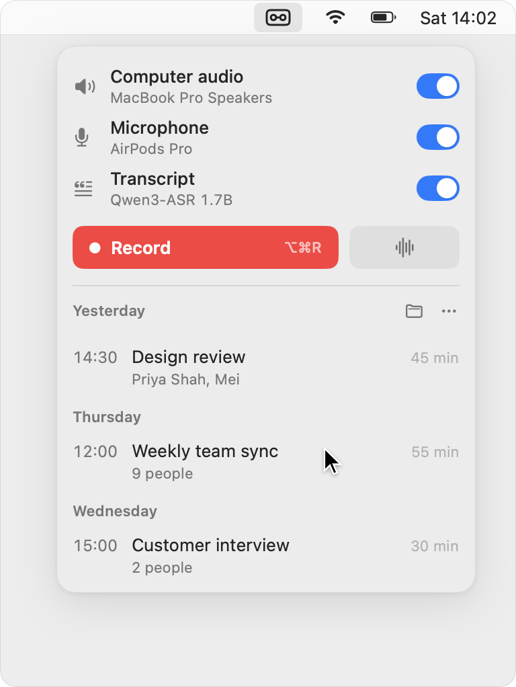
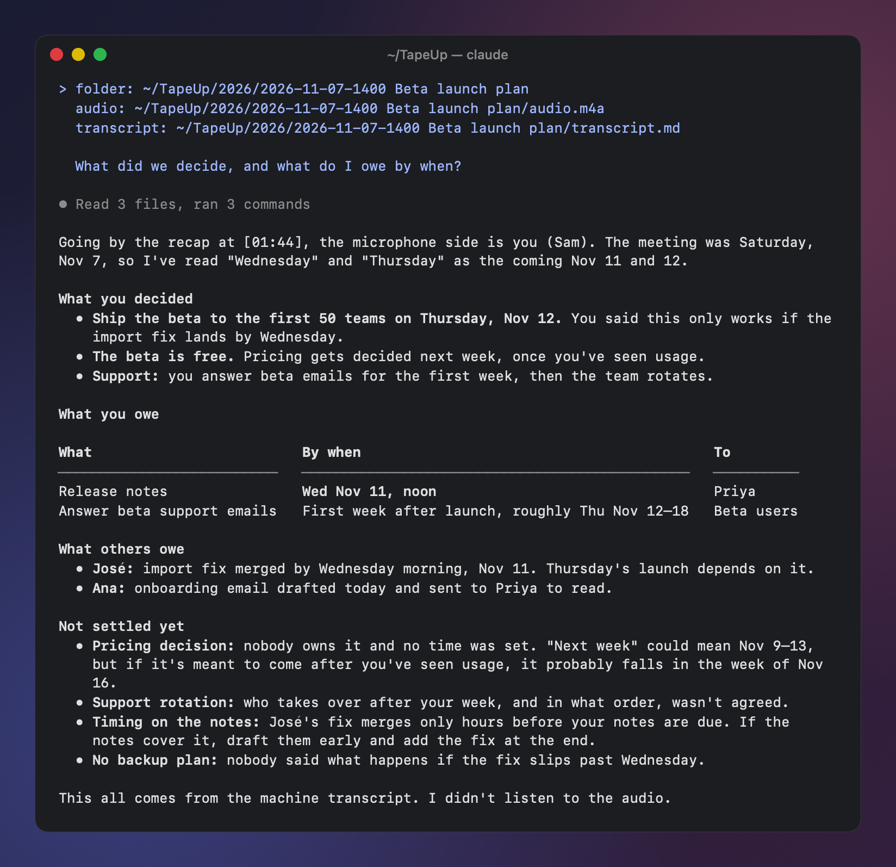

<p align="center">
  
</p>

<h1 align="center">TapeUp</h1>

<p align="center">
  <b>Record any meeting on your Mac. Get a transcript you and your AI agent can use.</b><br>
  A click records both sides of the call: your voice and everything your Mac plays.<br>
  TapeUp transcribes it on your Mac while you talk.
</p>

<p align="center">
  <a href="https://github.com/kkyrian/tapeup/releases/latest/download/TapeUp.dmg"><b>Download for Mac</b></a>
  &nbsp;·&nbsp; free and open source &nbsp;·&nbsp; macOS 15 or later, Apple silicon
</p>

<p align="center">
  
</p>

Or with [Homebrew](https://brew.sh):

```bash
brew install kkyrian/tap/tapeup
```

The first time you open it, macOS asks you to confirm. [Here is why, and how](#opening-tapeup-the-first-time).

## Two ways to use it

**Just want transcripts?** Click the TapeUp icon in the menu bar and press
Record, or press **⌥⌘R** from any app. Talk as usual; the latest words
appear as you go. Stop, and the recording is saved with its transcript and a
title made from what was said. Copy the transcript, or open the folder.

**Work with an AI agent?** Press **Copy path** and paste it into Claude Code,
Codex or any agent that reads files. Ask what you need.

<p align="center">
  
</p>

That is a real answer from Claude Code, given only the pasted path. It knows
which lines are yours because TapeUp kept your microphone and the call apart.

## Made for your agent

Most recorders hand you a transcript. TapeUp hands your agent a recording it
can understand on its own and a few seconds of context only you can give.

### Every recording explains itself

Each recording is a folder, and the recordings folder carries a guide for
agents, `AGENTS.md`, that says what every file means.

```
~/TapeUp/
├── AGENTS.md            what everything here means, for any agent
├── people.json          the people you meet with, and who you are
└── 2026/
    └── 2026-11-07-1400 Beta launch plan/
        ├── audio.m4a                            left: your mic, right: your Mac's sound
        ├── transcript.md                        timed lines, marked Microphone or Computer audio
        ├── transcript-with-speaker-labels.md    who said what, once you ask for it
        ├── meta.json                            when, how long, devices, who was there
        └── events.jsonl                         what happened while it recorded
```

Add your own rules at the end of `AGENTS.md` (where summaries go, how to name
them). TapeUp never rewrites what you add.

### Context in seconds


When a recording stops, TapeUp asks the two things a transcript can't know:
how many people were there (one tap) and who they were (names suggested from
your past meetings). Ask for speaker labels and it tells the voices apart, so
the transcript says who said what.

All of it is written into the folder, where your agent finds it.

<br clear="right">

### Your agent can run TapeUp

The app has a command line for agents: name a recording, transcribe it again,
label its speakers. Errors say what went wrong and whether to retry.

```bash
tapeup=/Applications/TapeUp.app/Contents/MacOS/TapeUp   # AGENTS.md tells agents this
$tapeup title 2026-11-07-1400 "Beta launch plan"
$tapeup speakers 2026-11-07-1400 --voices 4
$tapeup transcribe 2026-11-07-1400 --json
```

`help` lists everything. Recording itself only ever starts in the app.

### Your own AI fills in the rest, if you want


In Settings, pick Claude Code or Codex, the one you already use and are signed
in to. TapeUp then asks it for titles and for who was there, from the
transcript. It is off until you pick one.

Your agent can also write your People list in one step, so names are
suggested and spelled right in transcripts.

<br clear="right">

## A good recorder on its own

- **Both sides, kept apart.** Your microphone and your Mac's sound are recorded
  together, on separate channels. No bot joins your call, and it works with
  any app: Zoom, Meet in a browser, Teams, a video, a lecture.
- **Keeps going when you switch.** Put in your AirPods or take them out
  mid-call and the recording carries on, in time.
- **Transcribed as you talk.** Qwen3-ASR runs on your Mac, in 52 languages
  and dialects. The words are ready when you stop.
- **Small and quick.** It lives in the menu bar. ⌥⌘R starts and stops from
  anywhere, and a floating control lets you pause or stop without opening it.
- **Nothing lost.** Audio is written as it records, so a crash or a dead
  battery keeps the meeting.

## Private by design

TapeUp has no account, no server and no tracking. Recording, transcription
and speaker labels all run on your Mac, and your recordings stay in a folder
you choose. It goes online only to download its speech models the first time
(2.3 GB on Macs with 16 GB of memory or more, 680 MB below). If you turn on
an agent, TapeUp sends that agent the transcript, the same as if you pasted it
in yourself.

Recording people may need their consent where you live. Tell them you're
recording.

## Questions

**How is this different from meeting notetakers?** Notetakers keep your
meetings in their cloud and give you their summary. TapeUp keeps them on your
Mac and gives them to the agent you already work with, which knows your
projects.

**Does it record notifications and music too?** Yes, everything your Mac
plays. Turn off Computer audio for a meeting in the room, or pause when you
need to.

**Can it tell me apart from the others?** With headphones, every line is
marked Microphone (you) or Computer audio (the call). Speaker labels go further
and tell individual voices apart.

**What does it need?** A Mac with Apple silicon and macOS 15 or later. It asks
for your microphone and for your Mac's audio the first time you record.

## Opening TapeUp the first time

TapeUp is free and not signed through Apple's paid developer program, so
macOS stops it the first time:

1. Open TapeUp. macOS says it can't verify it; click **Done**.
2. Open **System Settings › Privacy & Security**, scroll to Security, and
   click **Open Anyway** next to TapeUp.
3. Confirm with your password. From then on it opens normally.

The source is all here if you'd rather [build it yourself](#build).

## Build

Requires Xcode with its Metal Toolchain
(`xcodebuild -downloadComponent MetalToolchain`).

```bash
make verify-full        # format check, build, tests, signed app
make install            # puts TapeUp in Applications and opens it
make uitest             # drives the real panel through every flow
```

The design and its decisions are in [`_docs/SYSTEM.md`](_docs/SYSTEM.md).
Contributions are welcome; open an issue first for anything large.

## License

MIT. See [LICENSE](LICENSE).
