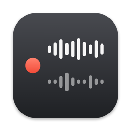
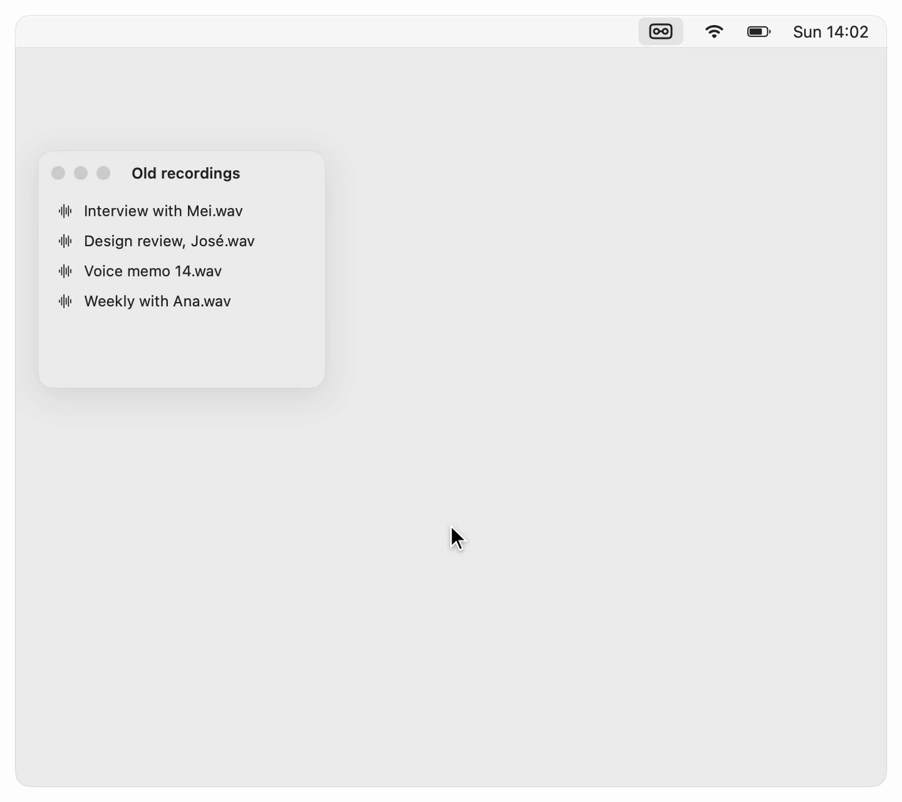
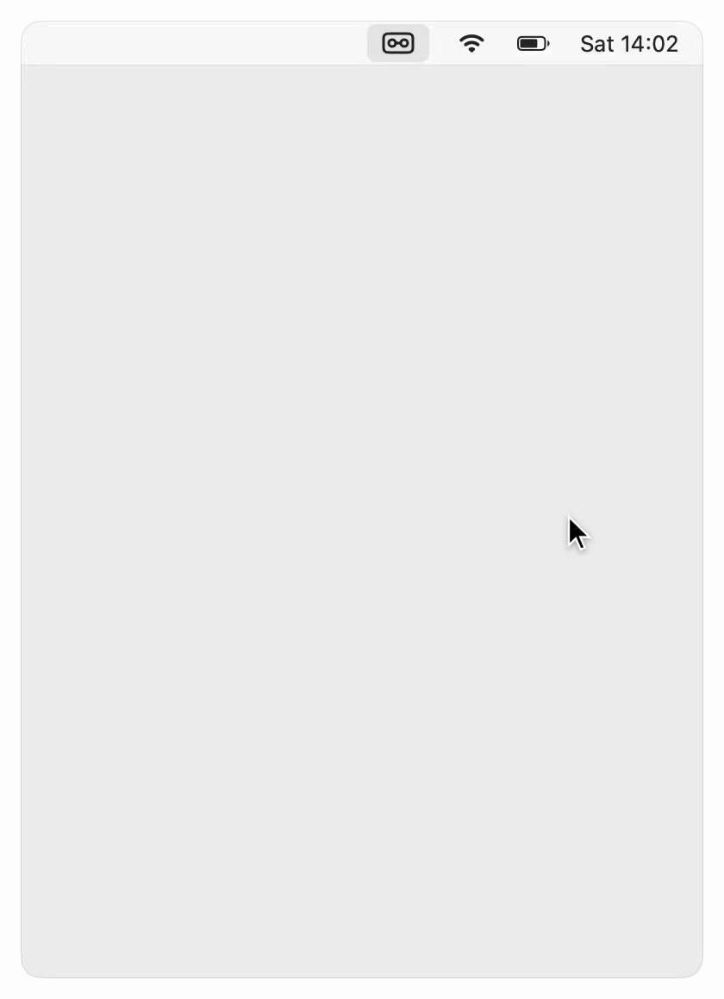
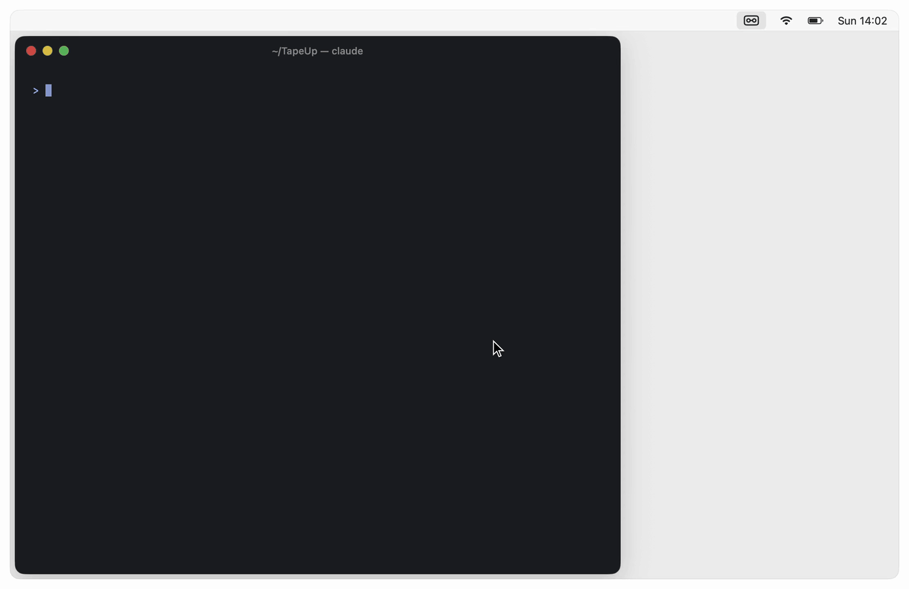
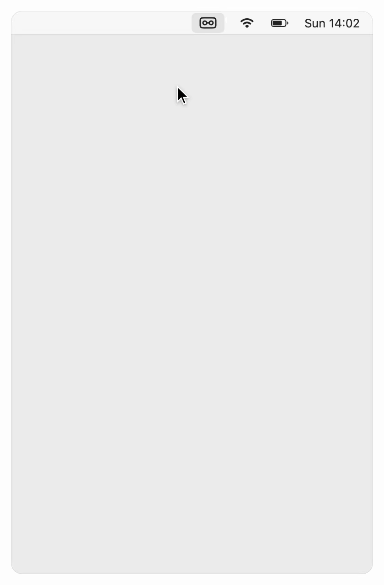
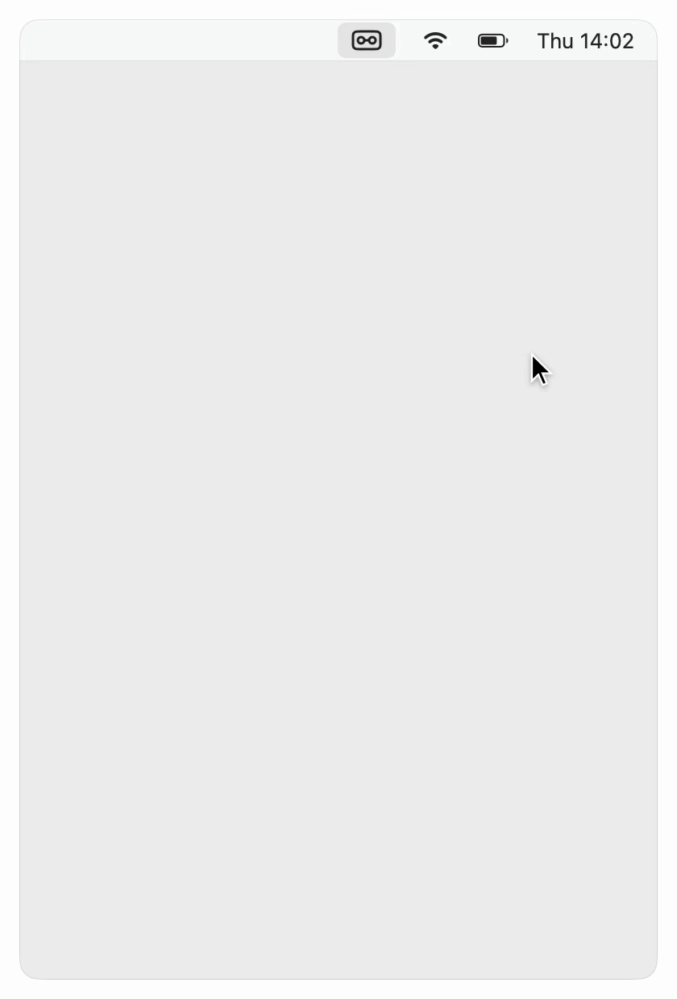
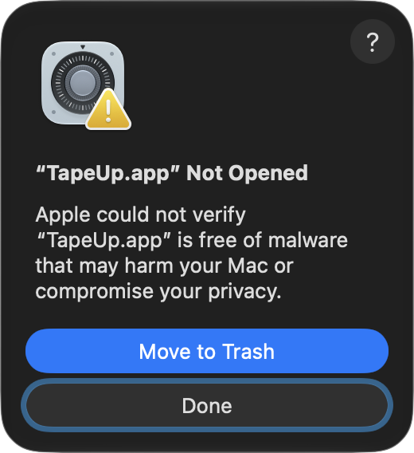
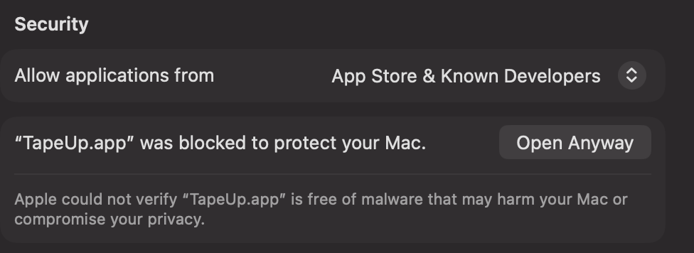

<p align="center">
  
</p>

<h1 align="center">TapeUp</h1>

<p align="center">A meeting recorder for Mac, built for you and your AI agent.</p>

<p align="center">
  <b>Record any meeting. Get a transcript you and your AI agent can use.</b><br>
  One click records your voice and everything your Mac plays.<br>
  TapeUp transcribes it on your Mac while you talk.
</p>

<p align="center">
  <a href="#install"><b>Download for Mac</b></a>
  &nbsp;·&nbsp; free and open source &nbsp;·&nbsp; Apple silicon, tested on macOS 27
</p>

```bash
brew install kkyrian/tap/tapeup
```

<p align="center">
  <picture>
    <source media="(prefers-color-scheme: dark)" srcset=".github/images/record-dark.gif">
    
  </picture>
  <picture>
    <source media="(prefers-color-scheme: dark)" srcset=".github/images/import-dark.gif">
    
  </picture>
</p>

<p align="center">Record a call, or import recordings you already have.<br>Both are transcribed on your Mac.</p>

<br>

<picture>
  <source media="(prefers-color-scheme: dark)" srcset=".github/images/speakers-dark.gif">
  
</picture>

### Know who said what

When you stop recording, tap how many people were on the call. Once the
transcript is ready, TapeUp finds that many voices and shows a line each
one said. Play a voice to hear who it is, then pick their name.

TapeUp remembers the voices you name. The next time you meet the same
people, it fills in their names for you. Voices stay on your Mac and are
never sent to your agent.

If you wear headphones, TapeUp marks your own lines as yours from the start.

<br clear="all">
<br>

### Hand it to your agent

Each recording is a folder with its audio and transcript. Click **Copy
path** and paste it into your agent of choice (for example, Claude Code or
Codex). Your agent reads the transcript and can answer anything about the
meeting.

<picture>
  <source media="(prefers-color-scheme: dark)" srcset=".github/images/handoff-dark.gif">
  
</picture>

<br>

<picture>
  <source media="(prefers-color-scheme: dark)" srcset=".github/images/all-recordings-dark.gif">
  
</picture>

### Find any meeting

**Show all** lists every recording by month. Search the titles, the
people in them, or anything that was said.

Filters show the recordings that have no transcript or no names yet. One click
transcribes all the ones that need it.

<br clear="all">
<br>

<picture>
  <source media="(prefers-color-scheme: dark)" srcset=".github/images/space-dark.gif">
  
</picture>

### Free up space

Remove the audio from old meetings and keep their transcripts, names and
voices. In the TapeUp panel, choose **Free Up Space…** from the ··· menu. It
shows which recordings will lose their audio before you confirm. Each
recording there has a lock: lock it to keep its audio.

<br clear="all">

## Also

- **Any app.** Zoom, Google Meet, Teams or a video. No bot joins your call.
  Press **⌥⌘R** in any app to start recording. Small controls float over your
  windows so you can pause or stop.
- **AI titles.** Choose Claude Code or Codex in Settings, and it titles each
  recording. Until you choose one, Apple Intelligence writes the titles on
  Macs that have it.
- **Your people list.** Add the people you meet, each with a short note, or let
  your agent write the list. TapeUp uses it to suggest names and to spell
  them right in transcripts. Rename someone, and the name changes in every recording.
- **Switch devices.** Connect or disconnect AirPods mid-call, and TapeUp keeps
  recording.
- **Nothing lost.** Audio is saved as it records, so you keep the meeting
  even if TapeUp crashes.
- **52 languages.** TapeUp transcribes meetings in 52 languages.
- **Private.** Recording and transcription run on your Mac. Only the agent
  you choose sees a transcript.

Recording people may need their consent where you live.

## The folder

Your recordings are plain files in `~/TapeUp`. `AGENTS.md` there tells
agents what each file is.

```
~/TapeUp/
├── AGENTS.md         what everything here means
├── people.json       who you meet with
└── 2026/2026-11-07-1400 Beta launch plan/
    ├── audio.m4a     your mic on the left, your Mac on the right
    ├── transcript.md
    └── meta.json     when, how long, who was there
```

## Command line

Your agent can also run TapeUp from the command line. It can import files,
transcribe them, name voices, edit your people list, and remove or lock
audio. Recording starts only from the app.

In the commands below, `TapeUp` stands for
`/Applications/TapeUp.app/Contents/MacOS/TapeUp`. To see every command with
examples, run:

```bash
TapeUp help
```

```text
TapeUp folder [<path> [--move]]
TapeUp import <file> [--title T]
TapeUp title <recording> <title>
TapeUp transcribe <recording>
TapeUp speakers <recording> [--voices N]
TapeUp voices <recording>
TapeUp voices name <recording> <voice> <person>
TapeUp people
TapeUp people add <name> [--context C]
TapeUp people rename <old> <new> [--merge]
TapeUp people remove <name>
TapeUp remove-audio <recording>
TapeUp keep <recording>
TapeUp agent [off] [--model M] [--effort E]
```

Wherever a command takes `<recording>`, give its folder, its start time
(`2026-11-06-1430`) or `latest`. `agent` picks the AI that writes titles.
Your agent names a voice only after you tell it who that is. It can lock
audio, and only you can unlock it.

## Install

Download [TapeUp.dmg](https://github.com/kkyrian/tapeup/releases/latest/download/TapeUp.dmg),
open it and drag TapeUp to Applications. Or install it with Homebrew:

```bash
brew install kkyrian/tap/tapeup
```

TapeUp isn't notarized by Apple yet, so macOS blocks it the first time you
open it. To open it:

1. Open TapeUp. When macOS says it can't verify it, click **Done**.
2. In **System Settings › Privacy & Security**, scroll to Security and click
   **Open Anyway** next to TapeUp.

<p align="center">
  
  &nbsp;
  
</p>

3. Click the cassette in the menu bar. TapeUp downloads its speech model
   once (2.3 GB, or 680 MB on Macs with less than 16 GB of memory).

After that, TapeUp updates itself. It checks once a day and never updates
while you record. **Check for Updates…** is in the ··· menu.

## Models

TapeUp runs open models on your Mac with [speech-swift](https://github.com/soniqo/speech-swift) on MLX:

- **Transcripts:** [Qwen3-ASR 1.7B](https://huggingface.co/aufklarer/Qwen3-ASR-1.7B-MLX-8bit) (8-bit).
  Macs with less than 16 GB of memory use [0.6B](https://huggingface.co/aufklarer/Qwen3-ASR-0.6B-MLX-4bit) (4-bit).
  [Silero](https://huggingface.co/aufklarer/Silero-VAD-v6.2.1-MLX) finds the pauses.
- **Speakers:** [Nemotron 3 Diarization](https://huggingface.co/aufklarer/Nemotron-3-Diarization-100M-MLX-INT8)
  and [WeSpeaker](https://huggingface.co/aufklarer/WeSpeaker-ResNet34-LM-MLX) voice prints.
- **Titles:** Claude Code or Codex if you choose one, with the model it is
  set to. Otherwise, Apple Intelligence on your Mac.

## Build

Needs Xcode and its Metal Toolchain (`xcodebuild -downloadComponent MetalToolchain`).

```bash
make verify-full   # format check, build, tests
make install       # puts TapeUp in Applications and opens it
```

The design and its decisions are in [`_docs/SYSTEM.md`](_docs/SYSTEM.md).
Issues and pull requests are welcome.

## License

MIT. See [LICENSE](LICENSE).
