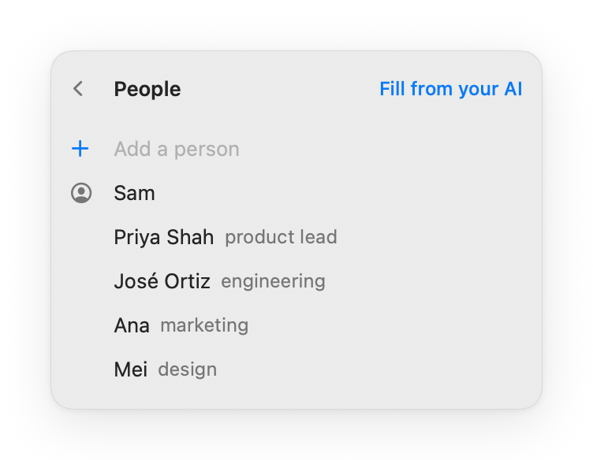

<p align="center">
  
</p>

<h1 align="center">TapeUp</h1>

<p align="center">
  <b>Record any meeting on your Mac. Get a transcript you and your AI agent can use.</b><br>
  A click records both sides of the call: your voice and everything your Mac plays.<br>
  TapeUp transcribes it on your Mac while you talk.
</p>

<p align="center">
  <a href="https://github.com/kkyrian/tapeup/releases/latest/download/TapeUp.dmg"><b>Download for Mac</b></a>
  &nbsp;·&nbsp; free and open source &nbsp;·&nbsp; macOS 15 or later, Apple silicon
</p>

<p align="center">
  <picture>
    <source media="(prefers-color-scheme: dark)" srcset=".github/images/flow-dark.gif">
    
  </picture>
</p>

Also on [Homebrew](https://brew.sh):

```bash
brew install kkyrian/tap/tapeup
```

TapeUp isn't notarized by Apple, so the first launch takes one extra step.
See [your first recording](#your-first-recording).

## Two ways to use it

**Want a transcript?** Click the cassette in the menu bar and press Record,
or press **⌥⌘R** in any app. Talk as usual. Stop, and the recording is saved
with its transcript and a title. Copy the transcript, or open its folder.

```
[00:04] Computer audio: Okay, so we ship the beta to the first fifty teams on Thursday.
[00:12] Microphone: That works if the import fix lands by Wednesday.
[00:18] Computer audio: José, can you own that fix?
[00:26] Computer audio: Yes, I'll have it merged by Wednesday morning.
```

**Work with an AI agent?** An agent here is an assistant that reads files on
your Mac, like Claude Code or Codex. You don't need one, but if you use one,
press **Copy path**, paste it in, and ask your question.

<p align="center">
  
</p>

That is Claude Code's real answer, given only what Copy path pasted: the
folder, the audio and the transcript. With headphones on, TapeUp keeps your
microphone and the call apart, so the agent knows which lines are yours.

## The recorder

- **Both sides, kept apart.** Your microphone and your Mac's sound are
  recorded together, on separate channels. No bot joins your call, and it
  works with any app: Zoom, Meet in a browser, Teams, a video, a lecture.
- **Keeps going when you switch.** Put in your AirPods or take them out
  mid-call and the recording carries on, in time.
- **Transcribed as you talk.** Qwen3-ASR runs on your Mac, in 52 languages
  and dialects. The transcript is ready moments after you stop.
- **Who said what.** With headphones, every line is marked Microphone (you)
  or Computer audio (the call). Press **Label speakers** to tell individual
  voices apart and name them.
- **Stays in the menu bar.** ⌥⌘R starts and stops from anywhere, and a small
  floating control lets you pause or stop without opening it.
- **Nothing lost.** Audio is written as it records, so a crash or a dead
  battery keeps the meeting.

## Private by design

TapeUp has no account, no server and no tracking. Recording, transcription
and speaker labels all run on your Mac, and your recordings stay in a folder
you choose. It goes online only to download its speech model the first time.
If you turn on an agent, TapeUp sends that agent the transcript, the same as
if you pasted it in yourself.

Recording people may need their consent where you live. Tell them you're
recording.

## Made for your agent

### Every recording explains itself

Each recording is a folder, and the recordings folder carries a guide for
agents, `AGENTS.md`, that says what every file means.

```
~/TapeUp/
├── AGENTS.md         what everything here means
├── people.json       who you meet with, and who you are
└── 2026/
    └── 2026-11-07-1400 Beta launch plan/
        ├── audio.m4a         left: your mic, right: your Mac
        ├── transcript.md     timed lines, yours marked Microphone
        ├── meta.json         when, how long, who was there
        └── events.jsonl      what happened while recording
```

Label speakers adds `transcript-with-speaker-labels.md`, naming who said each
line. Add your own rules at the end of `AGENTS.md`, such as where summaries go;
TapeUp never rewrites what you add.

### Who was there

<picture>
  <source media="(prefers-color-scheme: dark)" srcset=".github/images/people-dark.png">
  
</picture>

When a recording stops, TapeUp asks what a transcript can't know: how many
people were there (one tap) and who they were (names suggested from your past
meetings). It writes both into the folder, where your agent finds them.

The names come from your People list. **Fill from your AI** on the People page
has your agent write it in one step, and the names are then spelled right in
transcripts too.

<br clear="right">

### Titles and names from your AI

In Settings, pick Claude Code or Codex, the one you already use and are
signed in to. TapeUp then asks it for each recording's title and who was
there. It is off until you pick one. Without an agent, titles come from
Apple's on-device model on Macs with Apple Intelligence.

### Your agent can run TapeUp

The app has a command line for agents: name a recording, transcribe it again,
label its speakers. A recording is named by its folder or the time it started.
Errors say what went wrong and whether to retry.

```bash
tapeup=/Applications/TapeUp.app/Contents/MacOS/TapeUp   # AGENTS.md tells agents this
$tapeup title 2026-11-07-1400 "Beta launch plan"
$tapeup speakers 2026-11-07-1400 --voices 4
$tapeup transcribe 2026-11-07-1400 --json
```

`help` lists everything. Recording only starts in the app, where you can see it.

## Questions

**How is this different from meeting notetakers?** Most notetakers keep your
meetings in their cloud and give you their summary. TapeUp keeps them on your
Mac and gives them to the agent you already work with, which knows your
projects.

**Does it record notifications and music too?** Yes, everything your Mac
plays. Turn off Computer audio for a meeting in the room, or pause when you
need to.

**Which speech model do I get?** Qwen3-ASR 1.7B on Macs with 16 GB of memory
or more (a 2.3 GB download), and 0.6B below (680 MB).

## Your first recording

TapeUp is free and not notarized through Apple's paid developer program, so
macOS stops it the first time:

1. Open TapeUp. macOS says it can't verify it; click **Done**.
2. Open **System Settings › Privacy & Security**, scroll to Security, and
   click **Open Anyway** next to TapeUp. Confirm with your password.
3. Click the cassette in the menu bar. TapeUp downloads its speech model once.
4. Press **⌥⌘R** and allow your microphone and your Mac's audio when asked.
   You're recording.

The source is all here if you'd rather [build it yourself](#build).

## Build

Requires Xcode with its Metal Toolchain
(`xcodebuild -downloadComponent MetalToolchain`).

```bash
make verify-full        # format check, build, tests, packaged app
make install            # puts TapeUp in Applications and opens it
make uitest             # drives the real panel through every flow
```

The design and its decisions are in [`_docs/SYSTEM.md`](_docs/SYSTEM.md).
Contributions are welcome; open an issue first for anything large.

## License

MIT. See [LICENSE](LICENSE).
